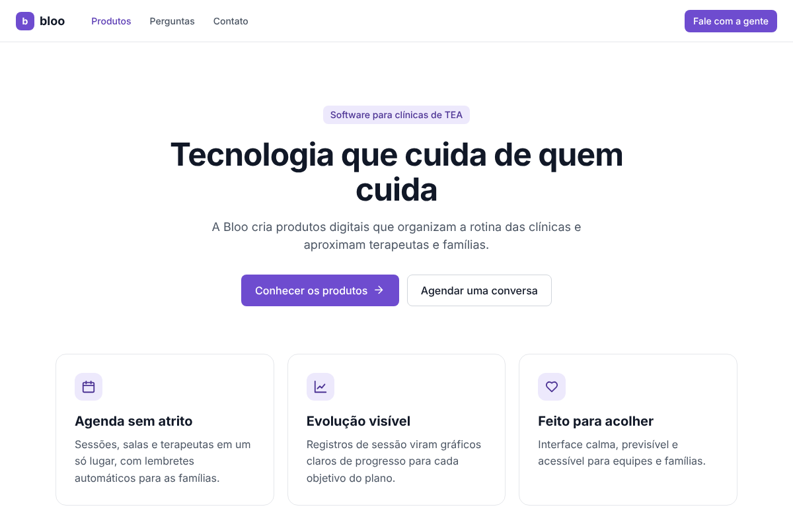
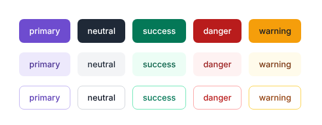
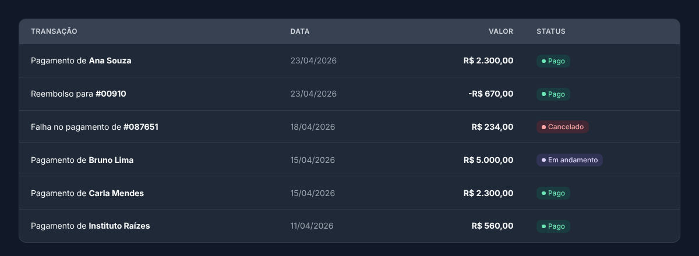
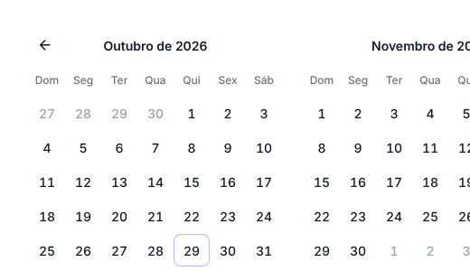

# Kaz

> **Repositório privado.** O Kaz é de uso interno da Bloo e de quem ela autorizar.

**O design system da Bloo.** Componentes React acessíveis, calmos e previsíveis, criados primeiro para produtos de clínicas de TEA e reaproveitados em todo o ecossistema Bloo.

[](https://github.com/silvestrev/kaz-design-system/actions/workflows/ci.yml)




---

## Sumário

- [Por que o Kaz existe](#por-que-o-kaz-existe)
- [Princípios](#princípios)
- [Instalação](#instalação)
- [Primeiros passos](#primeiros-passos)
- [Temas: claro, escuro e sistema](#temas-claro-escuro-e-sistema)
- [Componentes](#componentes)
- [Exemplos de uso](#exemplos-de-uso)
- [Tokens de design](#tokens-de-design)
- [Personalização](#personalização)
- [Acessibilidade](#acessibilidade)
- [Storybook](#storybook)
- [Desenvolvimento local](#desenvolvimento-local)
- [Estrutura do projeto](#estrutura-do-projeto)
- [Como criar um novo componente](#como-criar-um-novo-componente)
- [Publicação no GitHub Packages](#publicação-no-github-packages)
- [Roadmap](#roadmap)
- [Licença](#licença)

---

## Por que o Kaz existe

A Bloo é uma software house que nasce focada em produtos B2B para clínicas que atendem pessoas no espectro autista. Esses produtos são usados o dia inteiro por terapeutas e equipes administrativas, e muitas vezes também pelas famílias. O Kaz garante que tudo o que a Bloo constrói:

- tenha **a mesma cara e o mesmo comportamento**, do site institucional ao sistema da clínica;
- seja **rápido de montar**, sem reinventar botão, formulário e tabela a cada projeto;
- seja **acessível e confortável**, com baixa carga sensorial e navegação previsível.

## Princípios

| Princípio | Na prática |
| --- | --- |
| **Calma antes de chamar atenção** | Roxo dessaturado, sombras suaves, animações curtas (120 a 200 ms) e nada se move sozinho por padrão. O carrossel não troca de slide automaticamente, a não ser que você peça. |
| **Previsível** | Poucas variantes, sempre com os mesmos nomes (`variant`, `tone`, `size`). O mesmo padrão faz sempre a mesma coisa. |
| **Acessível de verdade** | Contraste WCAG AA, foco visível, teclado em todos os componentes interativos, ARIA correto e respeito ao "reduzir movimento" do sistema. |
| **Claro e direto** | Textos padrão em português simples. Um botão principal (`solid primary`) por área. |

## Instalação

O pacote `@silvestrev/kaz` fica no **GitHub Packages** (privado). Para instalar, o projeto precisa saber onde buscar o escopo `@silvestrev` e ter um token com acesso.

1. Crie um token em **GitHub → Settings → Developer settings → Personal access tokens (classic)** com o escopo `read:packages`.
2. Na raiz do projeto que vai usar o Kaz, crie um `.npmrc`:

```ini
@silvestrev:registry=https://npm.pkg.github.com
//npm.pkg.github.com/:_authToken=${GITHUB_TOKEN}
```

3. Exporte o token (ou configure como segredo no CI) e instale:

```bash
export GITHUB_TOKEN=seu_token
npm install @silvestrev/kaz
```

> Nunca faça commit do token. O `.npmrc` acima lê a variável de ambiente.
>
> No GitHub Actions de outro repositório da Bloo, use `NODE_AUTH_TOKEN: ${{ secrets.GITHUB_TOKEN }}` e dê ao repositório acesso ao pacote em **Package settings → Manage Actions access**.

**Requisitos:** React 18 ou superior e `react-dom`. O Kaz não tem outras dependências em tempo de execução.

**Fonte (recomendado):** o Kaz usa a [Inter](https://fonts.google.com/specimen/Inter). Se ela não estiver carregada, cai para a fonte do sistema.

```html
<link rel="preconnect" href="https://fonts.googleapis.com" />
<link rel="preconnect" href="https://fonts.gstatic.com" crossorigin />
<link href="https://fonts.googleapis.com/css2?family=Inter:wght@400;500;600;700&display=swap" rel="stylesheet" />
```

## Primeiros passos

1. Importe o CSS **uma vez** na raiz da aplicação.
2. Envolva a aplicação com o `KazProvider`.
3. Use os componentes.

```tsx
// main.tsx
import '@silvestrev/kaz/styles.css';
import { KazProvider, KazButton, KazIcon } from '@silvestrev/kaz';

export function App() {
  return (
    <KazProvider theme="light">
      <KazButton leftIcon={<KazIcon name="calendar" />}>Agendar sessão</KazButton>
    </KazProvider>
  );
}
```

### Next.js (App Router)

Os componentes já saem marcados com `"use client"`, então podem ser usados dentro de Server Components sem configuração extra.

```tsx
// app/layout.tsx
import '@silvestrev/kaz/styles.css';
import { KazProvider } from '@silvestrev/kaz';

export default function RootLayout({ children }: { children: React.ReactNode }) {
  return (
    <html lang="pt-BR">
      <body>
        <KazProvider theme="system">{children}</KazProvider>
      </body>
    </html>
  );
}
```

### Vite

Nada a configurar: importe o CSS e use.

## Temas: claro, escuro e sistema

```tsx
<KazProvider theme="light" />  // claro (padrão)
<KazProvider theme="dark" />   // escuro
<KazProvider theme="system" /> // segue o sistema operacional
```

Provedores podem ser aninhados, por exemplo uma faixa escura dentro de uma página clara. O hook `useKazTheme()` devolve o tema efetivo (`'light'` ou `'dark'`).

<p>
  
  
</p>

## Componentes

Todos os componentes começam com o prefixo **`Kaz`**. As props seguem os mesmos nomes em toda a biblioteca:

- `variant`: aparência (`solid`, `soft`, `outline`, `ghost`...)
- `tone`: cor semântica (`primary`, `neutral`, `success`, `warning`, `danger`, `info`)
- `size`: tamanho (`sm`, `md`, `lg` e, quando faz sentido, `xs` e `xl`)

### Ações

| Componente | Para que serve | Destaques |
| --- | --- | --- |
| `KazButton` | Ação principal ou secundária | 5 variantes, 5 tons, 5 tamanhos, ícones, `loading`, `iconOnly`, vira link com `href` |
| `KazButtonGroup` | Botões encostados (ex.: Anos / Meses / Dias) | Use `pressed` no item ativo |
| `KazDropdown` | Menu de ações | Teclado completo (setas, Home/End, Esc), itens `danger`, divisórias, cabeçalho |

### Formulários

| Componente | Para que serve | Destaques |
| --- | --- | --- |
| `KazInput` | Campo de texto | Rótulo, ajuda, erro e sucesso ligados por ARIA, ícones, botão de limpar, 3 tamanhos |
| `KazTextarea` | Texto longo | Mesmos estados do `KazInput` |
| `KazSelect` | Lista de opções | Select nativo estilizado (melhor no celular e para leitores de tela) |
| `KazCheckbox` | Marcar opções | Estado parcial (`indeterminate`), descrição |
| `KazRadio` / `KazRadioGroup` | Escolher uma opção | Grupo com `fieldset` e `legend`, vertical ou horizontal |
| `KazSwitch` | Ligar/desligar com efeito imediato | `role="switch"` |
| `KazSlider` | Valor ou intervalo numérico | Um ou dois controles, balão com valor, `formatValue` |
| `KazAutocomplete` | Busca com sugestões | Padrão combobox, grupos, destaque do trecho buscado, remover recentes, rodapé com ação |
| `KazCalendar` | Calendário | Data única ou período, 1 ou 2 meses, seletor de mês e ano, datas bloqueadas, teclado |
| `KazDatepicker` | Campo de data | Abre o calendário, confirmação Ok/Cancelar opcional, formato pt-BR |

### Navegação e layout

| Componente | Para que serve | Destaques |
| --- | --- | --- |
| `KazTopbar` | Barra superior | Logo, navegação, busca, ações, menu do usuário, tons `light`, `dark`, `brand` |
| `KazSidebar` | Menu lateral | Seções, subitens expansíveis, contadores, modo compacto (só ícones ou iniciais), 3 tons |
| `KazTabs` | Abas | `underline`, `pill`, `segmented`, teclado (setas, Home/End) |
| `KazBreadcrumb` | Caminho da página | Simples ou com fundo, `aria-current` no item atual |
| `KazPagination` | Paginação | Números com reticências, setas ou anterior/próxima, resumo "Mostrando 1 a 10 de 100" |
| `KazAccordion` | Conteúdo recolhível | Um ou vários abertos, `contained`, `separated`, `flush` |
| `KazListGroup` | Lista de itens/links | Item ativo, ícones, conteúdo à direita |
| `KazDivider` | Separador | Horizontal, vertical, com texto |

### Feedback e sobreposição

| Componente | Para que serve | Destaques |
| --- | --- | --- |
| `KazAlert` | Aviso contextual | 5 tons, título, ações, fechar, `role` correto por urgência |
| `KazBadge` | Etiqueta ou status | `soft`, `solid`, `outline`, ícone, ponto, contador circular |
| `KazModal` | Diálogo | Foco preso, Esc fecha, foco devolvido, trava a rolagem, 4 tamanhos, modo centralizado |
| `KazTooltip` | Dica curta | Abre com mouse **e** teclado, 4 posições, `dark`, `light`, `subtle` |
| `KazProgress` | Progresso | 6 tons, 3 tamanhos, rótulo e porcentagem |
| `KazSpinner` | Carregando | `ring` ou `arc`, gira mais devagar com "reduzir movimento" |

### Dados e mídia

| Componente | Para que serve | Destaques |
| --- | --- | --- |
| `KazTable` | Tabela de dados | Colunas tipadas, `render` por célula, zebrada, compacta, estado vazio, clique na linha |
| `KazAvatar` | Foto ou iniciais | Cai para iniciais se a imagem falhar |
| `KazCarousel` | Carrossel | Setas e indicadores dentro/fora, legenda, sem troca automática por padrão |
| `KazSparkline` | Minigráfico de tendência | Linha suave ou reta, área com degradê, descrição acessível |
| `KazIcon` | Ícones de traço | Conjunto mínimo usado pelos componentes, decorativo por padrão |

## Exemplos de uso

### Formulário com validação

```tsx
import { KazButton, KazInput, KazSelect, KazCheckbox } from '@silvestrev/kaz';

function CadastroPaciente() {
  const [email, setEmail] = useState('');
  const erro = email && !email.includes('@') ? 'Digite um e-mail válido.' : undefined;

  return (
    <form style={{ display: 'grid', gap: 16 }}>
      <KazInput label="Nome do responsável" required />
      <KazInput label="E-mail" type="email" value={email} onChange={(e) => setEmail(e.target.value)} error={erro} />
      <KazSelect
        label="Especialidade"
        placeholder="Selecione"
        options={[
          { value: 'aba', label: 'Terapia ABA' },
          { value: 'fono', label: 'Fonoaudiologia' },
        ]}
      />
      <KazCheckbox label="Aceito receber lembretes por WhatsApp" />
      <KazButton type="submit">Cadastrar</KazButton>
    </form>
  );
}
```

### Tabela com status

```tsx
import { KazTable, KazBadge, type KazTableColumn } from '@silvestrev/kaz';

type Sessao = { id: string; paciente: string; data: string; status: 'confirmada' | 'cancelada' };

const colunas: KazTableColumn<Sessao>[] = [
  { key: 'paciente', header: 'Paciente', rowHeader: true },
  { key: 'data', header: 'Data' },
  {
    key: 'status',
    header: 'Status',
    render: (s) => <KazBadge tone={s.status === 'confirmada' ? 'success' : 'danger'} dot>{s.status}</KazBadge>,
  },
];

<KazTable columns={colunas} data={sessoes} getRowKey={(s) => s.id} striped caption="Sessões da semana" captionHidden />;
```



### Escolher um período

```tsx
import { KazDatepicker, type KazDateRange } from '@silvestrev/kaz';

const [periodo, setPeriodo] = useState<KazDateRange>({ start: null, end: null });

<KazDatepicker mode="range" label="Período do relatório" value={periodo} onChange={setPeriodo} />;
```



### Confirmação antes de excluir

```tsx
<KazModal
  open={aberto}
  onClose={() => setAberto(false)}
  size="sm"
  centered
  footer={
    <>
      <KazButton tone="danger" onClick={excluir}>Sim, excluir</KazButton>
      <KazButton variant="outline" tone="neutral" onClick={() => setAberto(false)}>Cancelar</KazButton>
    </>
  }
>
  Tem certeza de que quer excluir este agendamento?
</KazModal>
```

### Layout de aplicativo

```tsx
<div style={{ display: 'flex', height: '100vh' }}>
  <KazSidebar
    header="bloo"
    sections={[
      {
        items: [
          { id: 'agenda', label: 'Agenda', icon: <KazIcon name="calendar" />, href: '/agenda', active: true },
          { id: 'pacientes', label: 'Pacientes', icon: <KazIcon name="user" />, href: '/pacientes' },
          { id: 'mensagens', label: 'Mensagens', icon: <KazIcon name="inbox" />, href: '/mensagens', badge: 3 },
        ],
      },
    ]}
  />
  <div style={{ flex: 1 }}>
    <KazTopbar
      brand="Clínica Raízes"
      search={<KazAutocomplete label="Buscar paciente" options={pacientes} onSelect={abrirPaciente} />}
      user={{ name: 'Ana Souza', email: 'ana@clinica.com.br', menu: [{ label: 'Sair', tone: 'danger' }] }}
    />
    {/* conteúdo */}
  </div>
</div>
```

## Tokens de design

Os tokens são variáveis CSS em duas camadas:

1. **Primitivos:** escalas fixas (`--kaz-purple-600`, `--kaz-gray-200`, `--kaz-space-4`...).
2. **Semânticos:** o que os componentes usam (`--kaz-color-surface`, `--kaz-primary-solid`...). São estes que mudam entre tema claro e escuro.

> Regra de ouro: no seu código, use sempre os tokens **semânticos**. Assim o tema escuro funciona sozinho.

### Cor

| Escala | 50 | 100 | 200 | 300 | 400 | 500 | **600** | 700 | 800 | 900 | 950 |
| --- | --- | --- | --- | --- | --- | --- | --- | --- | --- | --- | --- |
| Roxo Kaz | `#f6f4fe` | `#ede9fc` | `#dcd4f9` | `#c2b4f3` | `#a28bea` | `#8466de` | **`#6e4ccf`** | `#5c3db5` | `#4c3394` | `#3f2c77` | `#261a4a` |

O roxo principal `#6e4ccf` tem contraste de 5,9:1 com texto branco (WCAG AA).

| Token semântico | Uso |
| --- | --- |
| `--kaz-color-bg` / `--kaz-color-bg-subtle` | Fundo da página |
| `--kaz-color-surface` / `-muted` / `-hover` / `-active` | Cartões, menus, estados de hover |
| `--kaz-color-border` / `-strong` | Bordas |
| `--kaz-color-text` / `-muted` / `-subtle` / `-disabled` | Hierarquia de texto |
| `--kaz-{tom}-solid` / `-solid-hover` / `-on-solid` | Fundo forte e texto sobre ele |
| `--kaz-{tom}-soft` / `-soft-text` / `-border` / `-text` | Fundo suave, texto, borda |
| `--kaz-focus-ring` | Anel de foco |

`{tom}` = `primary`, `neutral`, `success`, `warning`, `danger`, `info`.

### Tipografia

| Token | Tamanho |
| --- | --- |
| `--kaz-text-xs` | 12px |
| `--kaz-text-sm` | 14px |
| `--kaz-text-md` | 16px |
| `--kaz-text-lg` | 18px |
| `--kaz-text-xl` | 20px |
| `--kaz-text-2xl` | 24px |
| `--kaz-text-3xl` | 30px |
| `--kaz-text-4xl` | 36px |
| `--kaz-text-5xl` | 48px |

Pesos: `--kaz-weight-regular` (400), `-medium` (500), `-semibold` (600), `-bold` (700).

### Espaço, raio, sombra e movimento

- **Espaço** (base 4px): `--kaz-space-1` (4px) até `--kaz-space-16` (64px).
- **Raio:** `--kaz-radius-sm` (4px), `-md` (8px), `-lg` (12px), `-xl` (16px), `-full`.
- **Sombra:** `--kaz-shadow-xs`, `-sm`, `-md`, `-lg`, sempre suaves.
- **Movimento:** `--kaz-duration-fast` (120ms), `--kaz-duration-normal` (200ms). Ambos viram 0 com "reduzir movimento".

Precisa só das variáveis, sem os componentes? Importe `@silvestrev/kaz/tokens.css`.

## Personalização

Sobrescreva os tokens no seu CSS, depois do import do Kaz:

```css
:root {
  --kaz-primary-solid: #5b3fc4;
  --kaz-radius-md: 0.375rem;
  --kaz-font-sans: 'Nunito', system-ui, sans-serif;
}

[data-kaz-theme='dark'] {
  --kaz-color-bg: #0f0a1f;
}
```

Todo componente aceita `className` e repassa props nativas (`onClick`, `id`, `data-*`, `aria-*`...). As classes seguem o padrão `kaz-bloco__elemento--modificador`, então dá para ajustar pontualmente quando preciso.

Os textos padrão estão em pt-BR e podem ser trocados por props, por exemplo `closeLabel` no `KazModal`, `labels` no `KazPagination` e `locale` no `KazCalendar`.

## Acessibilidade

O Kaz foi pensado para quem usa teclado, leitor de tela, zoom ou tem sensibilidade a estímulos visuais.

- **Contraste:** combinações de texto e fundo atendem WCAG 2.2 AA nos dois temas.
- **Foco:** anel de foco visível (`:focus-visible`) em todos os elementos interativos.
- **Teclado:**
  - `KazTabs`: setas, Home e End.
  - `KazDropdown`: setas, Home, End, Esc devolve o foco ao botão.
  - `KazAutocomplete`: setas, Enter escolhe, Esc fecha ou limpa.
  - `KazCalendar`: setas movem o dia, PageUp/PageDown trocam o mês, Home/End vão ao início/fim da semana.
  - `KazModal`: foco preso dentro do diálogo, Esc fecha, foco volta para quem abriu.
  - `KazCarousel`: setas esquerda e direita.
- **Leitores de tela:** rótulos ligados com `label`/`aria-describedby`, `aria-invalid` em erros, `aria-current` em navegação, `role="alert"` só para mensagens urgentes.
- **Movimento:** todas as transições respeitam `prefers-reduced-motion`. O carrossel não roda sozinho por padrão e pausa ao receber foco ou mouse.

O Storybook tem o addon **a11y** ligado: cada história mostra as verificações automáticas na aba "Accessibility".

## Storybook

Toda a documentação viva dos componentes está no Storybook, em português, com controles interativos e alternância de tema na barra de ferramentas.

```bash
npm run storybook   # http://localhost:6006
```

Inclui uma página inicial de exemplo completa em **Exemplos → Página inicial da Bloo**.

O workflow `storybook.yml` publica no GitHub Pages, mas roda só manualmente: Pages em repositório privado exige um plano pago do GitHub. Para usar, ative **Settings → Pages → Source: GitHub Actions** e rode o workflow em **Actions**.

## Site da Bloo

A landing page de apresentação da Bloo fica no repositório [silvestrev/bloo-web](https://github.com/silvestrev/bloo-web) e consome o Kaz pelo GitHub Packages. É o melhor exemplo de uso real da biblioteca.

## Desenvolvimento local

```bash
git clone https://github.com/silvestrev/kaz-design-system.git
cd kaz-design-system
npm install
npm run storybook
```

| Script | O que faz |
| --- | --- |
| `npm run storybook` | Storybook em modo desenvolvimento (porta 6006) |
| `npm run build-storybook` | Gera o Storybook estático em `storybook-static/` |
| `npm run build` | Gera a biblioteca em `dist/` (ESM, CJS, tipos e CSS) |
| `npm test` | Roda os testes (Vitest + Testing Library) |
| `npm run typecheck` | Verifica os tipos com TypeScript |

## Estrutura do projeto

```
kaz-design-system/
├── .github/workflows/     # CI, publicação do Storybook e do npm
├── .storybook/            # Configuração do Storybook (tema, decorators)
├── docs/assets/           # Imagens do README
├── src/
│   ├── components/
│   │   └── KazButton/
│   │       ├── KazButton.tsx          # Componente
│   │       ├── KazButton.css          # Estilos (só tokens)
│   │       └── KazButton.stories.tsx  # Histórias do Storybook
│   ├── docs/              # Páginas de fundamentos e exemplos
│   ├── styles/
│   │   ├── tokens.css     # Tokens primitivos e semânticos (claro e escuro)
│   │   ├── base.css       # Base comum e classes de tom
│   │   └── index.css      # Junta tudo no styles.css final
│   ├── utils/             # cx, useControllable, useDismiss, tipos
│   ├── __tests__/         # Testes
│   └── index.ts           # Exportações públicas
├── tsup.config.ts         # Build da biblioteca
└── package.json
```

## Como criar um novo componente

1. Crie a pasta `src/components/KazNome/` com `KazNome.tsx`, `KazNome.css` e `KazNome.stories.tsx`.
2. Use **apenas tokens semânticos** no CSS e classes com o prefixo `kaz-nome`.
3. Reaproveite as props padrão (`variant`, `tone`, `size`, `className`) e repasse as props nativas.
4. Garanta teclado, foco visível e ARIA. Textos padrão em pt-BR, com prop para trocar.
5. Adicione o `@import` do CSS em `src/styles/index.css` e o `export` em `src/index.ts`.
6. Escreva ao menos um teste em `src/__tests__/` e uma história no Storybook com tema claro e escuro conferidos.
7. Registre a mudança no `CHANGELOG.md`.

## Publicação no GitHub Packages

O pacote se chama `@silvestrev/kaz` e é publicado de forma privada no GitHub Packages (`publishConfig` no `package.json`).

**Automática (recomendado):** atualize a versão, faça merge na `main` e publique uma *Release* no GitHub. O workflow `publish.yml` publica a versão do `package.json` usando o `GITHUB_TOKEN` do próprio repositório; não precisa criar segredo.

```bash
npm version patch   # ou minor / major
git push --follow-tags
```

**Manual:** com um token que tenha `write:packages`:

```bash
npm login --scope=@silvestrev --registry=https://npm.pkg.github.com
npm publish
```

O `prepublishOnly` roda tipos, testes e build antes de publicar.

## Segurança do repositório

- **Proteção da `main`**: as regras ficam em [`.github/rulesets/proteger-main.json`](.github/rulesets/proteger-main.json). Para aplicar, vá em **Settings → Rules → Rulesets → New ruleset → Import a ruleset** e escolha esse arquivo. Elas bloqueiam push direto, force push e exclusão da `main`, e exigem PR com o CI (`check`) verde e histórico linear (squash).
- **CODEOWNERS**: toda mudança passa pelo dono do repositório.
- **Dependabot**: atualizações semanais do npm e mensais das Actions, agrupadas para não lotar de PRs.
- **CI com permissões mínimas**: os workflows só pedem o acesso de que precisam.

Rulesets em repositório privado exigem o plano GitHub Pro (ou Team). No plano gratuito, as regras só valem em repositório público.

## Roadmap

- [ ] Biblioteca Figma espelhando os tokens e componentes
- [ ] `KazToast` (notificações temporárias) e `KazDrawer` (painel lateral)
- [ ] `KazStepper` para fluxos em etapas (ex.: cadastro de paciente)
- [ ] Testes visuais automáticos no CI
- [ ] Tokens exportados também em JSON (para apps móveis)

## Licença

Software proprietário. © 2026 Bloo. Todos os direitos reservados. Veja [LICENSE](LICENSE).
